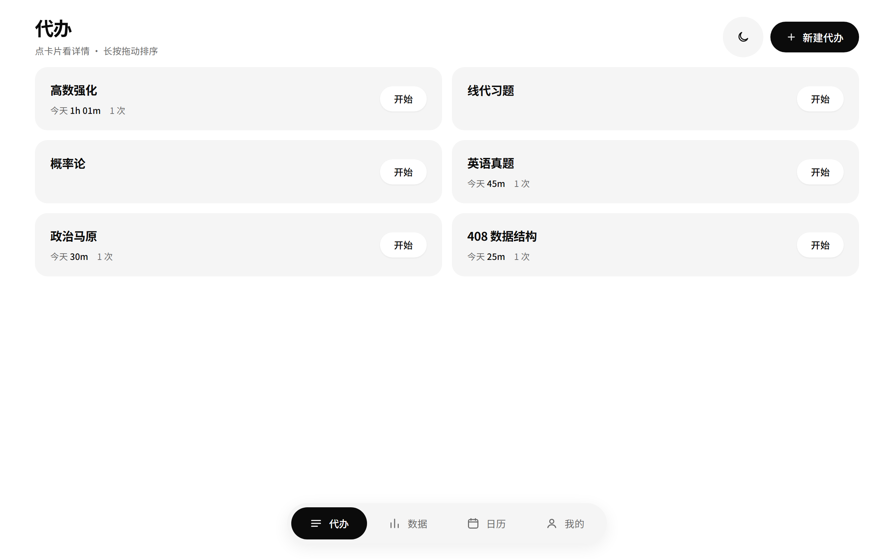
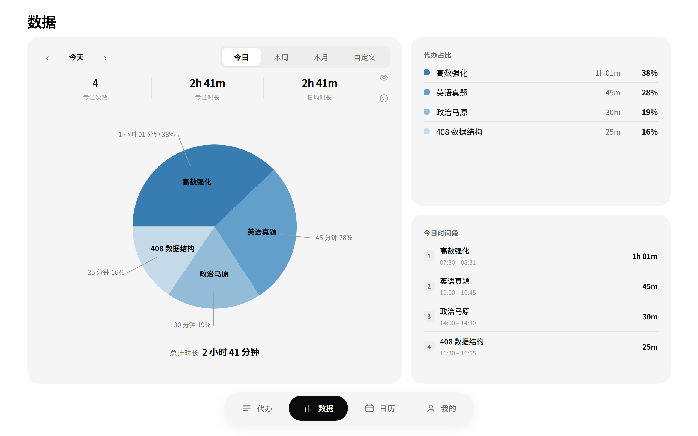
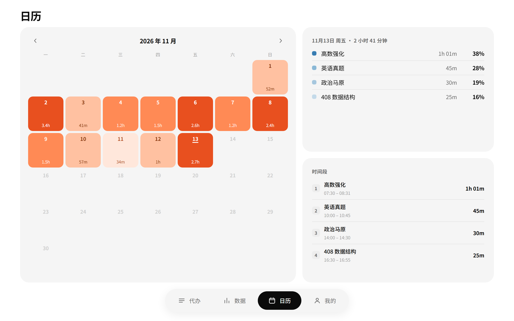
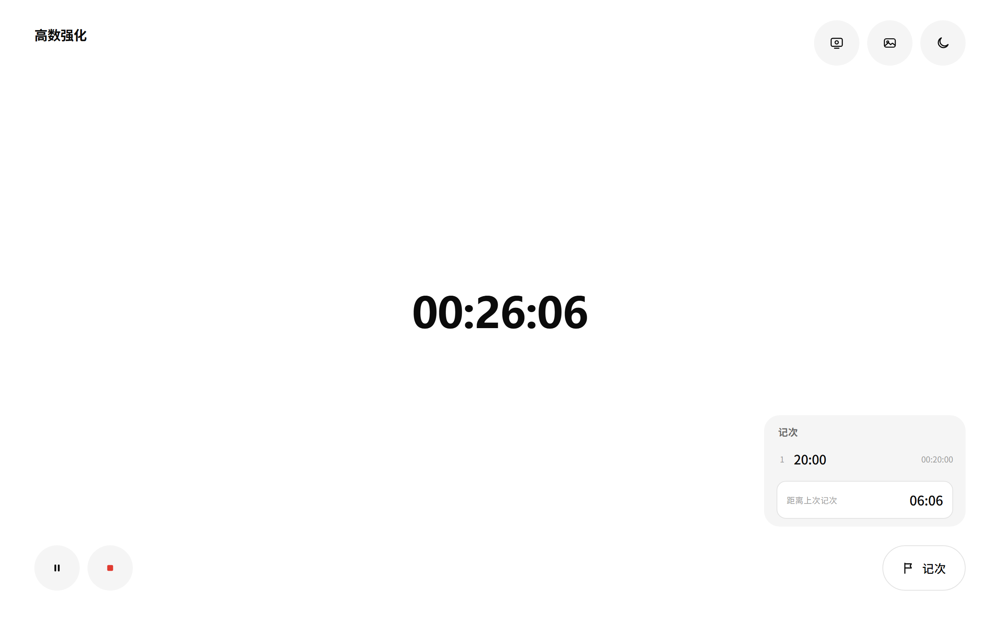
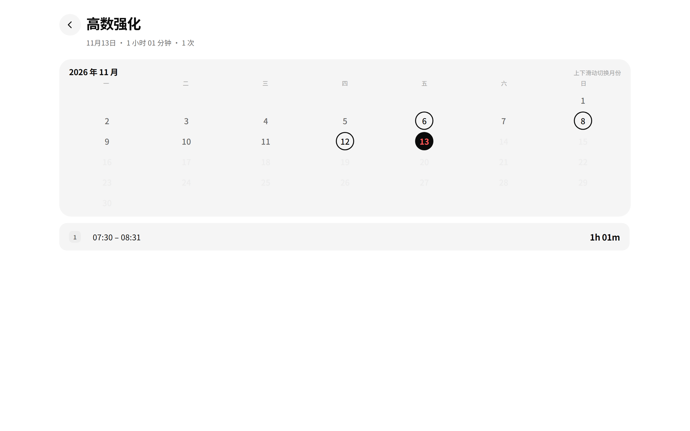
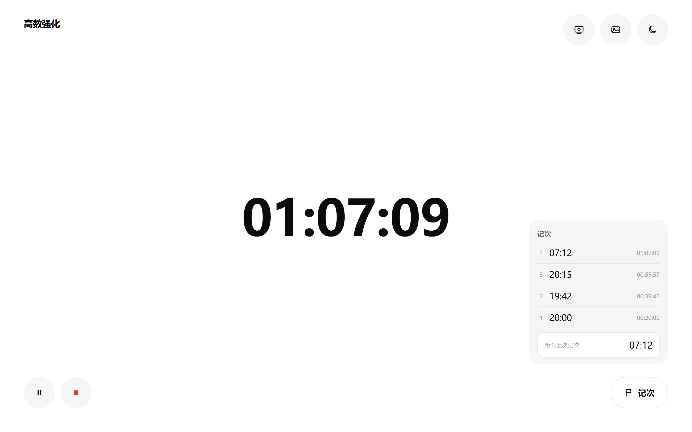

# 刻时 · EtchTime

<p>
<a href="release/EtchTime-v1.0.apk">
  
</a>
</p>

> 极简的专注计时器。不是番茄钟的倒计时，而是**按代办记账式记录时间**：正计时、按天统计、日历回看、记次分段。
>
> Android 平板横屏优先（1280×800 设计），手机竖屏也能用。纯本地存储，无账号、无网络请求。

**安装**：点上面的黑色按钮下载 `EtchTime-v1.0.apk`（77 KB），传到平板后安装，需要允许「安装未知来源应用」。要求 Android 10 及以上。



## 功能

| 模块 | 说明 |
|---|---|
| **代办** | 新建 / 点名称改名 / 长按拖动排序 / 点左侧卡片弹出重命名与编辑 |
| **正计时** | 点击开始进入全屏计时；暂停弹窗不计时；暂停时长累计显示 |
| **记次** | 计时刻按「记次」，右侧面板显示每段间隔与累计；最多 6 条，超出滚动 |
| **数据** | 今日 / 本周 / 本月 / 自定义区间，扇形图 + 占比 + 专注次数/时长/日均 |
| **按天查看** | `‹ ›` 翻前一天/后一天，或点日历图标选任意一天 |
| **日历** | 月历按天着色，点某天看当天全部记录 |
| **历史** | 每个代办一条月历，有记录的日期描边，点开看当天流水 |
| **我的** | 导出 / 导入备份、清空数据 |
| **外观** | 全局日间 / 夜间；计时页可换自定义背景图；扇形图 6 套单色渐变 |
| **通知栏** | 计时中常驻通知，显示代办名与实时时长 |

<table>
<tr>
<td></td>
<td></td>
</tr>
<tr>
<td></td>
<td></td>
</tr>
</table>



## 计时精度

这是本项目的核心设计点，也是它比一般网页计时器可靠的原因：

- **全部用时间戳计算**：`有效时长 = now − 开始时间 − 暂停累计`，只在渲染时刷新，不靠 `setInterval` 累加，不会随掉帧漂移
- **状态实时落盘**：开始时刻、每段暂停都写进 `localStorage`，杀进程 / 断电 / 重启后重开 App 会从原始时间戳恢复
- **息屏、切后台、锁屏都不影响结果**，因为重算用的是绝对时间
- **跨零点按自然日切分**：一次跨午夜的计时会分别计入两天
- 暂停段单独记录并从总时长中扣除

## 技术栈

- **前端**：原生 HTML / CSS / JavaScript，无框架、无构建步骤、无依赖
- **外壳**：Android WebView（`MainActivity` + `TimerService` 前台服务）
- **存储**：`localStorage`（`timelog.db.v1` / `timelog.current.v1` / `timelog.pref.v1`）
- **打包**：`aapt2` + `javac` + `d8` + `zipalign` + `apksigner`（不用 Gradle）

## 目录结构

```
.
├── web/                 # 前端（可直接用浏览器打开）
│   ├── index.html
│   ├── styles.css
│   ├── app.js
│   └── assets/          # 演示背景图
├── android/             # WebView 外壳
│   ├── AndroidManifest.xml
│   ├── src/com/apricity/timelog/
│   │   ├── MainActivity.java
│   │   └── TimerService.java
│   └── res/             # 图标、字符串
├── tools/               # 开发工具
│   ├── build_apk.ps1    # 一键打包
│   ├── add_to_apk.py    # 以正斜杠路径写入 APK 资源
│   ├── make_icon.py     # 生成启动图标
│   ├── build_preview.py # 合成单文件预览
│   ├── test.html        # 自动化自测（18 项）
│   ├── seed.html        # 灌演示数据
│   └── convert_tomato.py# 番茄Todo 导出转本应用备份
├── docs/screenshots/    # 截图
├── release/             # 可直接安装的 APK
└── mock/                # 设计稿
```

## 跑起来

### 只看界面（不需要 Android）

直接用浏览器打开 `web/index.html` 即可，数据存浏览器 localStorage。

也可以生成单文件预览：

```bash
python tools/build_preview.py   # 产出 preview.html
```

### 打包 APK

环境要求：JDK 17+、Android SDK（build-tools + platform android-36）、Python 3 + Pillow。

```powershell
powershell -NoProfile -ExecutionPolicy Bypass -File tools\build_apk.ps1
```

脚本内部依次执行：`aapt2 compile` → `aapt2 link` → `javac` → `d8` → 写入 assets 与 `classes.dex` → `zipalign` → `apksigner`。

首次打包会在 `keystore/` 自动生成签名密钥（口令在脚本里），**请自行替换并妥善保管**，否则后续无法覆盖升级。

## 数据格式

导出 / 导入使用同一份 JSON：

```json
{
  "app": "刻时",
  "version": 1,
  "exportedAt": "2026-11-13T20:00:00",
  "todos":    [{ "id": "t001", "name": "高数强化", "createdAt": 1731500000000 }],
  "sessions": [{ "id": "s001", "todoId": "t001",
                 "start": 1731500000000, "end": 1731503600000,
                 "pauses": [[1731501000000, 1731501180000]],
                 "laps": [1200000, 2400000] }]
}
```

- `start` / `end`：毫秒时间戳
- `pauses`：暂停区间数组
- `laps`：记次时刻（相对开始的有效毫秒数），可选

`tools/convert_tomato.py` 可以把「番茄Todo」导出的 xls 转成本格式，方便迁移历史数据。

## 已知限制

- 仅支持 Android 10+（`minSdk 29`），未上架应用商店
- 数据只存在本机，跨设备靠导出 / 导入
- 通知栏小图标目前复用启动图标，部分 ROM 上可能显示为彩色块
- 平板横屏是主设计场景，竖屏仅做了基础适配

## 贡献

欢迎 issue 与 PR。提交前请跑一遍自测：

```bash
# 用浏览器打开 tools/test.html，页面里会输出 18 项检查结果
```

## License

[MIT](LICENSE)
