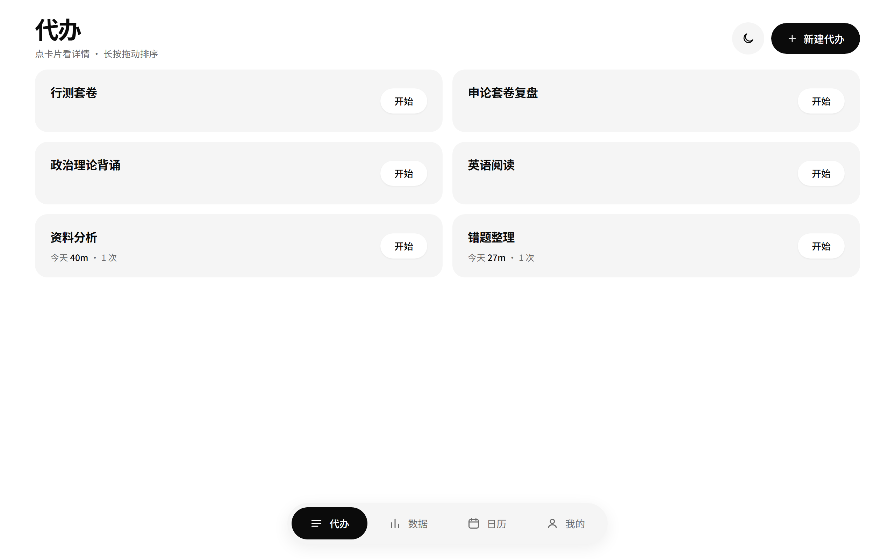
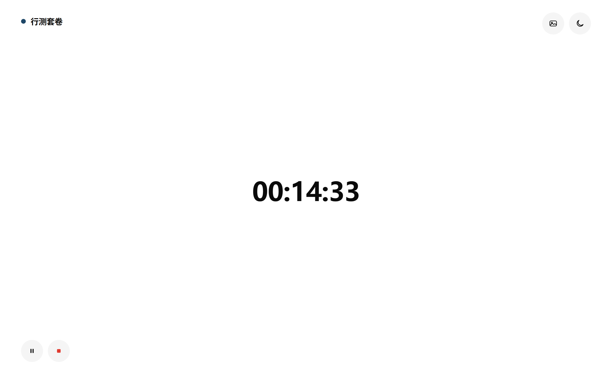
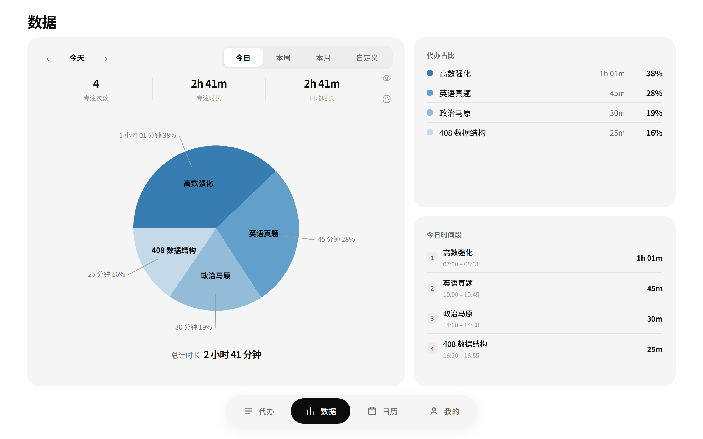
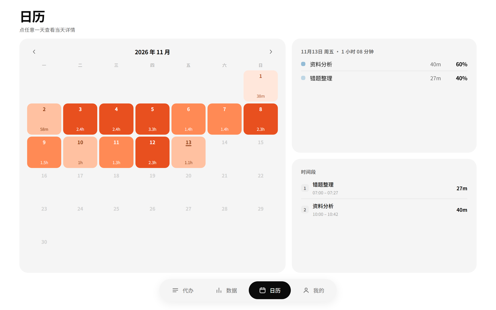
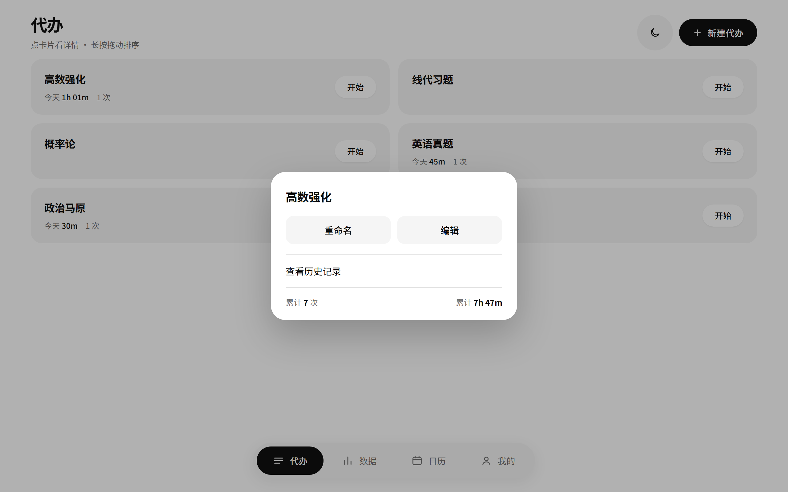
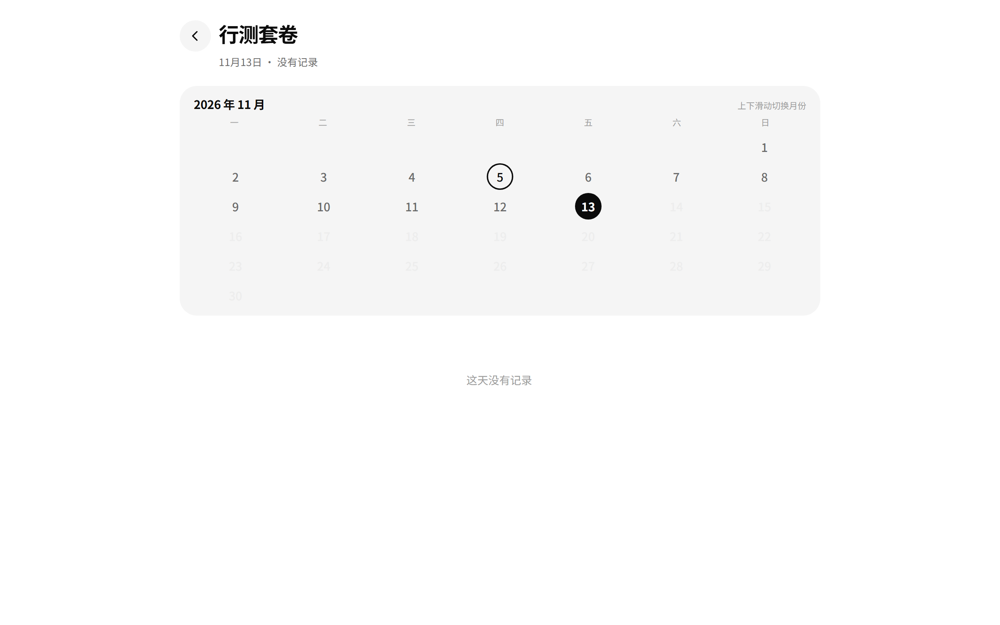

# 刻时 · 界面说明

按底部四个 Tab（代办 / 数据 / 日历 / 我的）加两个全屏页（计时 / 代办历史）逐个说明。

> 全局规则先说清楚，后面各页都按它算：
>
> - **一天从凌晨 4:00 开始**：00:00–03:59 记的时长算前一天，04:00 之后算当天
> - **不足 10 秒的计时直接丢弃**，不进任何统计
> - **暂停时间不计入**，跨天会按天切开分别统计

---

## 1. 代办页（首页）

**页头**

- 右上圆形按钮「月亮 / 太阳」：切换全局日间 / 夜间主题，所有页面一起变
- 右上黑色按钮「+ 新建代办」：输入名字（最多 20 字）后创建

**代办卡片**

- 卡片里是：代办名 + 今天的数据（`今天 1h 02m　3 次`），今天没有记录时不显示这一行
- 右侧「开始」按钮：立刻开始计时并进入计时页；如果已有正在进行的计时，会先问「××还在计时，要先结束它再开始新的吗」
- **点卡片左半边**：弹出卡片菜单（重命名 / 编辑 / 查看历史记录 / 累计次数与累计时长）
- **点卡片右半边或按钮附近**：不响应，避免误触
- **长按拖动**：按住卡片上下拖动可以调整顺序，松手即保存

**卡片菜单里**

- `重命名`：只改名字，历史记录仍挂在同一个代办上
- `编辑`：可改名字和总时长（右下角「删除这个代办」在这里，删除会连带删掉它的所有记录）
- `查看历史记录`：进入这个代办的历史页

---

## 2. 计时页

**左上**：当前计时的代办名

**中间**：大号正计时 `00:12:34`，每秒刷新

**右上三个圆钮**

| 按钮 | 作用 |
|---|---|
| 屏幕图标 | **保持屏幕常亮**。默认开启，只在「计时页 + 计时中 + 未暂停」时生效；关闭后按钮变成反色实心 |
| 图片图标 | 换一张本地图片做计时页背景；换上后旁边出现「×」可以移除 |
| 月亮 / 太阳 | 切换全局主题 |

**左下两个圆钮**

- 暂停：弹出「已暂停」窗口，显示累计暂停时长，点「结束暂停」继续；**暂停期间不计时**
- 停止（红色）：弹出确认框，确认后结算本次计时；不足 10 秒会提示「本次不足 10 秒，不计入数据」

**右下「记次」按钮**

- 按一下记一次，手机轻震；面板只在你记过第一次之后才出现
- 面板在「记次」按钮正上方，**新增条目向上生长**
- 每行：序号 · 距离上次记次的时长 · 累计时长
- 底部「距离上次记次 00:07:12」实时跳动，暂停时跟着停
- 最多 6 行，超出后面板内部滚动；不做删除（按错了只能继续往下记）

**层级**：暂停弹窗出现时，记次面板和「记次」按钮保持在弹窗同一层，不会被压暗

---

## 3. 数据页

**顶部日期导航（左）**

- `‹` `›`：前一天 / 后一天，不能翻到未来
- 中间日期文字：**点一下**弹出小月历，可翻月、点任意一天查看
- 没选具体日期时显示「今天 / 本周 / 本月 / 自定义」

**顶部区间选择（右）**

- `今日` `本周` `本月`：按自然区间统计
- `自定义`：弹出起止日期选择，可选「全部时间」

**三个统计数字**

- 专注次数：区间内有效记录条数
- 专注时长：区间内总时长
- 日均时长：总时长 ÷ 区间天数
- 右侧**眼睛按钮**：一键隐藏这三个数字（截图 / 分享时用），再点恢复

**扇形图**

- 每块扇区对应一个代办，名称写在扇区内，用直线拉出「时长 + 占比」
- 引线带防重叠处理，文字贴边时会自动换向，不会压住文字或互相重叠
- 下方「总计时长」
- **调色板按钮**：6 套配色（蓝 / 绿 / 橙 / 紫 / 灰 / 粉），**颜色深浅按时长排序**——占比最大用最深色，依次变浅，三个页面统一

**右侧两栏**

- 代办占比：代办名 · 时长 · 百分比，按占比从大到小排列，颜色和扇形图一致
- 今日时间段 / 当日时间段：当天每条记录的代办名、起止时间、时长；**点某一条可以修改时间或删除**

---

## 4. 日历页

**左侧月历**

- 顶部 `‹ 2026 年 11 月 ›` 切换月份
- 每格显示日期 + 当天总时长，背景色是**五档热力**：

| 档 | 当天时长 | 颜色 |
|---|---|---|
| 1 | 1 小时以内 | 极浅橙 |
| 2 | 1–3 小时 | 浅橙 |
| 3 | 3–5 小时 | 中橙 |
| 4 | 5–7 小时 | 橙红 |
| 5 | 7 小时以上 | 红褐 |

- 今天：日期文字带下划线
- 被选中的那天：格子描一圈黑边
- 点任意一天，右侧同步变成那天的数据

**右侧两栏**

- 顶部是「11月14日 周六 · 2 小时 41 分钟」加上当天各代办占比
- 下面是当天所有时间段，按开始时间排序

---

## 5. 我的

- 顶部头像和昵称，下面一行「已专注 X 小时 · N 次计时」（全部历史累计）
- `导出备份`：把全部数据存成一个 JSON 文件，保存到系统「下载」目录
- `导入备份`：选择 JSON 文件恢复数据，**会覆盖当前数据**，导入前建议先导出
- `清空所有数据`：二次确认后清空代办和记录，同时停掉正在进行的计时和通知
- 底部提示：数据只存在本机，换设备请先导出备份

---

## 6. 代办历史页

从代办卡片菜单的「查看历史记录」进入。

- 顶部 `‹`：返回数据页；标题是代办名，下面一行是当前选中那天的汇总
- **月历**：有记录的日期会被圈出来，今天带下划线，选中的那天实心
- **上下滑动月历**可以切换月份，左右滑动不响应（避免误触）
- 下方是该代办当天的流水：序号 · 起止时间 · 时长
- **点某一条**：可以「修改时间」或删除

---

## 7. 弹出层一览

| 弹窗 | 触发方式 | 内容 |
|---|---|---|
| 卡片菜单 | 点代办卡片左半边 | 重命名 / 编辑 / 查看历史 / 累计数据 |
| 记录弹窗 | 点时间段里的某条记录 | 修改时间 / 删除 |
| 选日期 | 点数据页的日期文字 | 小月历，翻月选日 |
| 配色 | 点数据页调色板 | 6 套配色方案 |
| 自定义时间段 | 数据页选「自定义」 | 起止日期，或全部时间 |
| 通用弹窗 | 新建 / 重命名 / 编辑 / 删除确认 | 输入框、时间滚轮、时长加减 |
| 暂停窗 | 计时页点暂停 | 累计暂停时长 + 结束暂停 |
| 结束确认 | 计时页点停止 | 时长会记到哪个代办，结束后回代办页 |

## 8. 手势与快捷键小结

| 操作 | 效果 |
|---|---|
| 点卡片左半边 | 打开卡片菜单 |
| 长按卡片拖动 | 调整代办顺序 |
| 点扇形图配色 | 切换配色方案 |
| 点眼睛按钮 | 隐藏 / 显示统计数字 |
| 点日期文字 | 打开小月历 |
| 月历上下滑 | 切换月份（历史页） |
| 安卓返回键 | 计时中返回无效（需先结束计时）；弹窗打开时返回 = 关闭弹窗 |
